<h1 align="center">Hi, I'm Mohamed Zanaty 👋</h1>

  Android developer · Computer &amp; Information Technology student at Ain Shams University

  
  
  
  
  

 

  

## 👨‍💻 About me

- 📱 Building Android apps with Kotlin and Jetpack Compose
- 🎓 3rd-year Computer & Information Technology student at Ain Shams University
- 🤝 Head of the Android Committee at the MSP Community, Ain Shams University
- ⚡ Competitive programming in C++ and C#

## 🛠️ Tech stack

  
  
  
  
  
  
  
  
  
  
  
  

## 🎮 Contribution graph

  <picture>
    <source media="(prefers-color-scheme: dark)" srcset="https://raw.githubusercontent.com/Mohamed8Zanaty/Mohamed8Zanaty/output/pacman-contribution-graph-dark.svg">
    <source media="(prefers-color-scheme: light)" srcset="https://raw.githubusercontent.com/Mohamed8Zanaty/Mohamed8Zanaty/output/pacman-contribution-graph.svg">
    
  </picture>

## 📊 GitHub stats

  <picture>
    <source media="(prefers-color-scheme: dark)" srcset="https://github-readme-stats.vercel.app/api?username=Mohamed8Zanaty&show_icons=true&theme=dracula">
    
  </picture>
  <picture>
    <source media="(prefers-color-scheme: dark)" srcset="https://github-readme-stats.vercel.app/api/top-langs?username=Mohamed8Zanaty&layout=compact&langs_count=6&theme=dracula">
    
  </picture>

